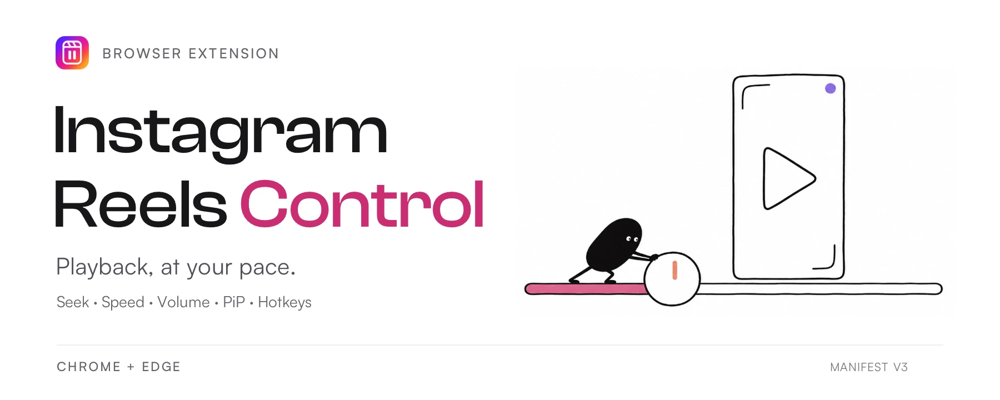

<p align="center">
  <picture>
    <source media="(max-width: 640px)" srcset="docs/assets/readme-banner-mobile.webp">
    
  </picture>
</p>

# Instagram Reels Control

A Manifest V3 extension that adds playback controls, seeking, volume, speed, Picture in Picture, hotkeys, and optional next-Reel auto-scroll to Instagram videos.

## Download and install

1. Download `instagram-reels-control-extension-v1.0.1.zip` from the [latest release](https://github.com/voxelepic/instagram-reels-control-extension/releases/latest). Access requires repository permission because this repository is private.
2. Extract the ZIP to a folder. Keep that folder in place after installation.
3. Open `chrome://extensions` in Chrome or `edge://extensions` in Edge and enable **Developer mode**.
4. Click **Load unpacked** and select the extracted folder containing `manifest.json`.
5. Refresh any open Instagram tabs, then use the toolbar extension icon to adjust settings.

Use the named extension ZIP under release assets. GitHub's automatic source-code archives require the build steps below before installation.

## Build and verify

```bash
npm install
npm test
npm run lint
npx tsc --noEmit
npm run build-ext
npm run validate
npm run test:browser
npm run test:extension
```

The unpacked extension is generated in `out/`. Load that directory from the browser's extension developer page.

`test:browser` exercises active-video selection, hotkeys, dynamic video mounting, storage updates, and duplicate initialization in headless Chrome. `test:extension` loads the actual unpacked extension in a temporary Chromium profile and verifies popup hydration plus `chrome.storage` persistence. The installed branded Chrome disables command-line unpacked-extension loading, so that packaging smoke test uses installed Microsoft Edge's Chromium runtime.

See `ARCHITECTURE.md` for runtime selection, lifecycle, cleanup, and settings behavior.
